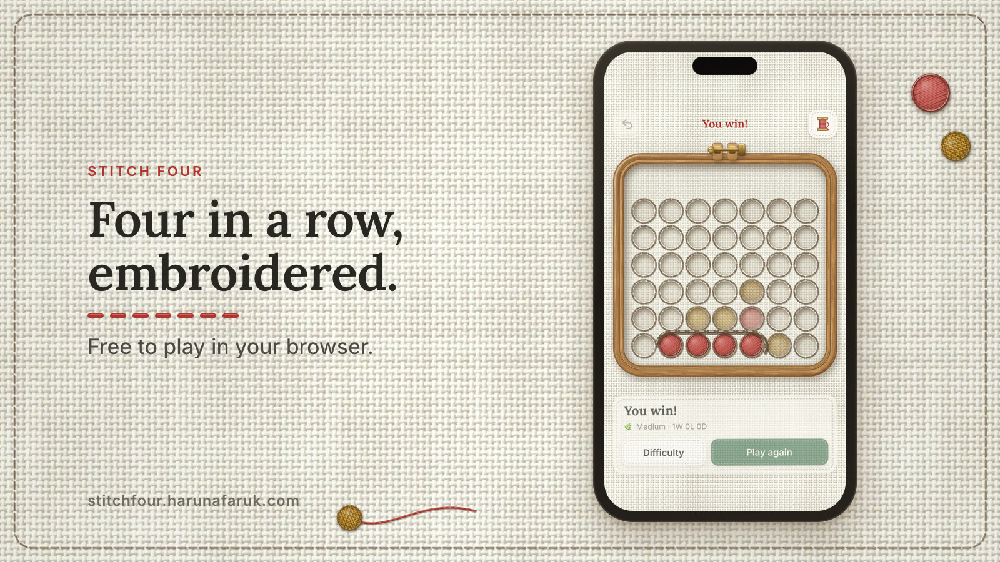
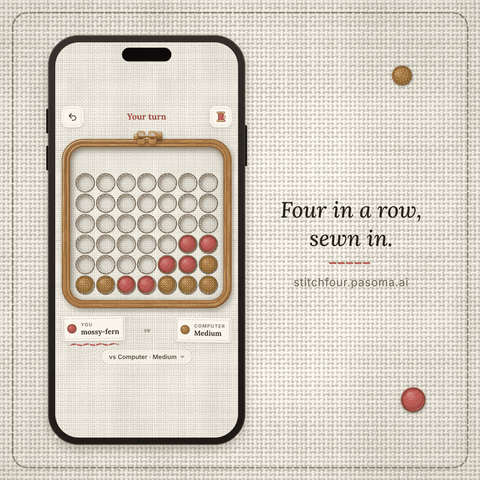
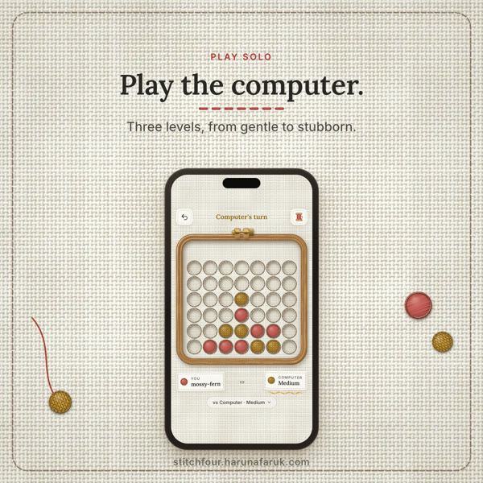
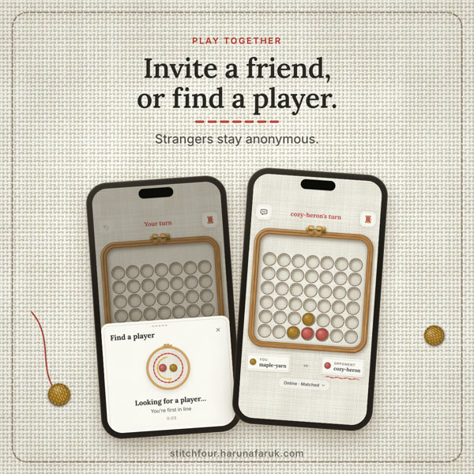
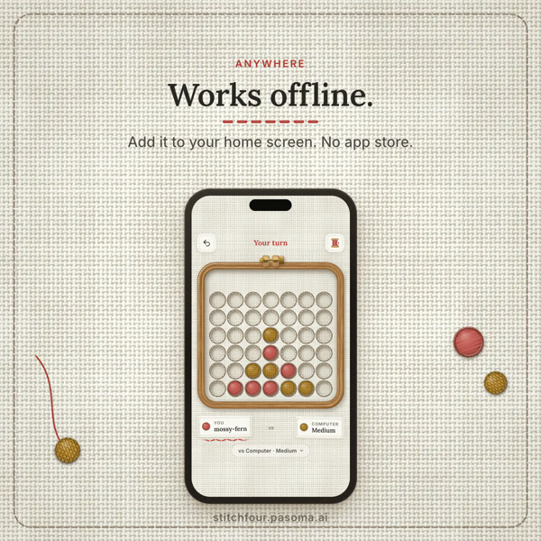
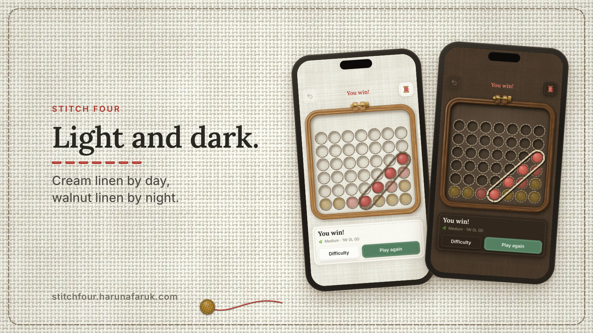

<div align="center">

# Stitch Four

**Four in a row, embroidered.**

A cozy four-in-a-row game sewn onto linen inside a wooden hoop.
Play the computer, pass the phone to a friend, invite someone with a link, or find a stranger online.
It installs to your home screen and works offline.

### [▶ Play at stitchfour.harunafaruk.com](https://stitchfour.harunafaruk.com)



</div>

---

<div align="center">
  
</div>

## Ways to play

<table>
  <tr>
    <td width="33%"></td>
    <td width="33%"></td>
    <td width="33%"></td>
  </tr>
  <tr>
    <td><b>vs Computer</b><br/>Three levels, from gentle to stubborn. The bot thinks in a background thread, so the board never stutters.</td>
    <td><b>Online</b><br/>Invite a friend with a 6-letter code or link, or tap <i>Find a player</i> to be paired with someone new. Matched players get random names, so strangers stay anonymous.</td>
    <td><b>Pass &amp; play</b><br/>Two players on one device. Like vs Computer, it works fully offline once the app has loaded.</td>
  </tr>
</table>

## The details

- **Embroidered look.** The linen is generated thread by thread with lighting, then baked into a small tiling texture. Every ring and piece is drawn as layered stitches (shadow, thread, twist, highlights, needle holes), once, and reused as sprites.
- **Feel.** Pieces fall with weight, squash a little and settle. The hoop stays rigid. A stitched belt sews itself around the winning four.
- **Sound.** Soft wooden drops, a cloth swish for a new game, gentle chimes. All CC0.
- **Light and dark.** Cream linen by day, navy denim by night.
- **Offline first.** It's an installable PWA. Updates arrive quietly and never interrupt a game in progress.
- **Fair online play.** The server checks every move, runs a 120-second turn timer, gives you 60 seconds to reconnect, and cleans up empty rooms.
- **Private by default.** No accounts, no cookies, no ads. Analytics are anonymous and can be turned off in the menu.



## How it's built

| Part | Tech |
|---|---|
| App | [Vite](https://vite.dev) + [React](https://react.dev) + TypeScript, [Motion](https://motion.dev) for animation |
| Rendering | Canvas 2D drawn once into sprites, CSS transforms for movement, SVG for the win belt |
| Bot | Negamax with alpha-beta pruning, bitboards and a transposition table, in a Web Worker |
| Offline | [vite-plugin-pwa](https://vite-pwa-org.netlify.app) (Workbox) |
| Online | [PartyServer](https://github.com/cloudflare/partykit/tree/main/packages/partyserver) on Cloudflare Durable Objects: one object per room, plus a matchmaking lobby |
| Hosting | Cloudflare Workers with static assets |

```
shared/    game rules, online protocol, names (used by browser, bot and server)
src/
  bot/     the computer player (search + worker)
  render/  canvas drawing: linen, hoop, stitches, pieces, win belt
  ui/      board, sheets, labels, crash screen
  lib/     settings, theme, analytics
  net/     online room + matchmaking clients
party/     Cloudflare Worker: rooms, lobby, rate limits, invite previews
scripts/   texture, icon, share-image and marketing generators
```

## Run it locally

You'll need [Bun](https://bun.sh).

```bash
bun install
bun run dev      # app + local Worker and Durable Objects at http://localhost:5173
bun run test     # game rules, bot, server logic
bun run build    # production build in dist/
```

Online play works locally too. Open two browser windows and create a room in one, or tap *Find a player* in both.

To deploy to your own Cloudflare account, change `routes` in `wrangler.jsonc` (or remove it to use workers.dev), then run `bun run deploy`.

Optional build variables are listed in [`.env.example`](.env.example).

## Credits

- Sound effects from [Kenney](https://kenney.nl) (CC0). See [`public/sounds/CREDITS.md`](public/sounds/CREDITS.md).
- Fonts: [Lora](https://fonts.google.com/specimen/Lora) and [Inter](https://rsms.me/inter/) (SIL Open Font License), self-hosted.
- The embroidery rendering was inspired by [StitchCraft](https://stitchcraft.wasmer.app).

## License

The code is [MIT](LICENSE). Feel free to learn from it, fork it and build on it.

The **Stitch Four** name, the app icon, the share image and the images in `docs/media/` are not part of the MIT license and stay all rights reserved. If you publish your own version, please give it a different name and icon. Sounds (CC0) and fonts (SIL OFL) keep their own licenses.
